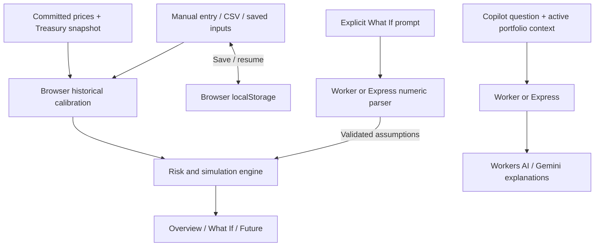

# RiskLab

**Understand your portfolio’s risk, test market assumptions, and explore possible outcomes.**

[Try RiskLab](https://risklab.us) · [Open the Lab](https://risklab.us/lab)

RiskLab is a personal research and engineering project for making portfolio risk
more understandable and inspectable. Bring your stock and ETF holdings, import a
CSV, or start with a sample. See what drives risk, ask “What if?”, and return to
saved portfolios as the underlying data is refreshed.

> **Explicit assumptions and historical data drive calculations. AI helps explain the results.**

## Why I built it

Risk tools often fall into one of two categories: opaque institutional systems or
simple dashboards that hide the assumptions behind the numbers. I started RiskLab
to make portfolio risk modeling both **interactive** and **inspectable**.

I also wanted to explore a practical role for AI: helping answer questions and
explain results about a portfolio while a testable quantitative engine handles the
calculations. The goal is to make it easier to understand what is driving a result
and question the assumptions behind it.

RiskLab began as an AI-assisted demo with hardcoded scenarios and illustrative
risk inputs. It has evolved into a Lab with historical models for covered holdings,
explicit user-defined stress assumptions, an optional Copilot companion, and
save/import workflows. Source-data checks and regression tests have grown with it;
independent model evaluation is still work to do.

## Explore the Lab

The welcome page introduces the project. **Enter the Lab** opens portfolio setup;
**Try a sample portfolio** opens an editable, historically calibrated example.
Overview starts with the actual holdings, amounts and allocations before showing
risk estimates.

| View | What it helps you inspect |
| --- | --- |
| **Overview** | Risk level, diversification, holdings that move together, and each ticker’s calculated share of volatility with an explanation of the inputs. Advanced metrics and methodology are available on demand. |
| **What If?** | The estimated effect of explicitly stated market or holding moves, with editable assumptions, holding-level impacts and a visible “Why this impact?” explanation. |
| **Future** | A range of simulated outcomes using historical portfolio volatility and an editable compound-growth assumption, with horizon and simulation controls. |

**Ask Copilot** opens beside these views. Opening the panel makes no AI request;
sending a question shares active portfolio context with the configured explanation
service. Answers identify their source, and an unavailable AI service offers an
opt-in rule-based summary. Calculations, CSV import and saved portfolios need no
LLM calls. What If uses the app’s numeric-scenario parser without AI inference.

For a new portfolio, What If starts with an empty prompt. Optional examples are
references for what to type. For example, `What if the stock market falls 20%?` supplies a measurable
assumption; a qualitative event without a direction and size asks for clarification.
The parser supports broad equities (SPY), Nasdaq-100 (QQQM), semiconductors (SMH),
10-year Treasury yield changes, and explicit held-ticker shocks. These inputs
produce conditional estimates, not predictions of market events.

## Bring your portfolio and keep your work

- **Build manually:** enter a portfolio value and allocations for up to 30 covered
  holdings. Every holding uses its own history; missing coverage blocks analysis.
- **Import CSV:** map ticker and current USD market-value columns, set a valuation
  date, then review totals, security types, duplicates and coverage before applying.
  Repeated tickers require confirmation to combine. Cash, unsupported currencies,
  unresolved rows and missing models block the import. No rows are silently dropped.
- **Save and resume:** explicitly save named holdings and What If/Future settings in
  this browser’s localStorage. Resume recalculates using the current snapshot.
  If coverage changes, the allocation is retained for review.
- **Back up:** download and restore versioned saved-portfolio JSON. Analysis JSON
  and holdings CSV exports are separate formats; the CSV importer accepts RiskLab’s
  own holdings export.

Allocation dates use **MM/DD/YYYY** in the interface and stay separate from the
historical model date. Imported values are preserved rather than replaced with
live prices. Importing alone does not save the new portfolio.

Raw CSV files and account columns stay in dialog memory and are cleared when the
import is closed or applied. Saved portfolios contain inputs and settings, not
cached risk results or Copilot conversations. Browser storage can be cleared and
is specific to a device, browser and origin; localhost, preview URLs and production
have separate libraries. RiskLab does not encrypt these saves or sync them to an account.
Copilot use later sends active portfolio context when the user asks a question.

Details: [CSV import](docs/csv-import.md) · [Saved portfolios and recovery](docs/saved-portfolios.md)

## Where the numbers come from

The committed snapshot contains adjusted historical prices and Treasury observations.
The browser loads it when entering the Lab, opening a sample or resuming a portfolio,
then reuses it for allocation changes. The listing directory is broader than usable
historical coverage. The app shows current coverage, data dates and provenance near
the bottom of setup and analysis pages; the manifest is the source of truth as
refreshes change those values.

| Calculation | Inputs and assumptions |
| --- | --- |
| Volatility, correlations and beta | Split/dividend-adjusted daily history aligned on matching return intervals; covariance is annualized using 252 trading days. |
| Risk contribution | A signed decomposition of portfolio volatility using allocation, standalone volatility and co-movement. A risk share is not a probability of loss; contributions can be negative or exceed 100%. |
| VaR, Expected Shortfall, Sharpe and Sortino | Parametric assumptions, historical arithmetic mean and portfolio volatility, with a fixed risk-free assumption where required. Normal-model tail estimates can understate extreme losses. |
| What If responses | Joint linear sensitivities estimated from the specified equity benchmarks and 10-year Treasury yield changes. Explicit holding shocks override estimates. Missing history or an unusable fit prevents a complete result. |
| Future outcomes | Constant-parameter geometric Brownian motion. The growth control begins at a dated SPY 10-year total-return benchmark and remains a user-editable assumption, separate from the portfolio’s historical mean. |

The batch checks completeness, corporate actions and common history, uses a
conservative cutoff when action feeds lag prices, and quarantines unexplained
extreme returns. These screens can also exclude genuine moves pending review.
The source is community-maintained; missing actions, ticker reuse and source
corrections can still affect results.

Models describe a short historical window and make distribution assumptions.
Large stress moves extrapolate daily relationships. Future does not include
contributions, withdrawals, taxes, fees or inflation adjustment, and its outcome
bands are not maximum-drawdown estimates. Successful tests, explained historical
variation and a fresh snapshot do not establish forecast accuracy.

Read the [scenario model](docs/scenario-model.md),
[data-quality policy](docs/historical-data-quality.md) and
[quantitative methodology](docs/quantitative-methodology.md).

## Run locally

Use Node.js 20+ and npm; CI uses Node 22. Python 3 is needed for the historical-data
and refresh/report tests (CI uses Python 3.12). The committed snapshot lets you
explore the Lab without market-data credentials or an AI key.

```sh
npm ci
npm run dev
```

Open [localhost:3000](http://localhost:3000). Express serves the API and Vite UI.

For optional local AI explanations, copy `.env.example` to `.env` and set
`GEMINI_API_KEY`. Keep real keys out of source control. The hosted app uses
Cloudflare Workers AI; local Express uses Gemini. Core analysis and the explicit
What If parser work without either provider.

```sh
cp .env.example .env
```

Build and run the Node production server:

```sh
npm run build
NODE_ENV=production npm start
```

To build for Cloudflare:

```sh
npm run build:cloudflare
```

The connected GitHub `main` branch deploys to Cloudflare after an approved PR is
merged. Feature branches receive preview builds. See the
[Cloudflare deployment guide](docs/cloudflare-deployment.md) for bindings and
manual deployment or Worker preview commands.

## Tests and release checks

The required **RiskLab validation** workflow runs TypeScript checks, every test
suite, a snapshot report, and both Node and Cloudflare builds. The AI tests mock
provider behavior; passing them does not prove live inference access or answer
quality. Changes are reviewed on feature branches and merged after approval.

```sh
npm run lint
npm run test:quant
npm run test:history
npm run test:ai
npm run test:symbols
npm run test:sample
npm run test:future
npm run test:portfolios
npm run test:csv
npm run test:refresh
npm run build
npm run build:cloudflare
```

Generate an offline snapshot report with `npm run report:risk-models`. CI uploads
the report, and weekly refresh PRs include a comparison with the previous snapshot.
Reports check input quality and regressions; independent-source reconciliation
and chronological model evaluation remain outstanding.

## Historical refreshes

Historical inputs are refreshed in batches. Browsing the app and editing
allocations do not request upstream prices or use AI inference tokens.

```sh
npm run refresh:risk-models
```

The optional macOS LaunchAgent **`com.risklab.weekly-refresh`** runs on Saturdays
at **10 PM in the Mac’s system time zone**. It uses a disposable checkout, runs the
refresh, report, tests and both builds, then opens a data PR when inputs change.
It never merges or deploys directly and uses no Codex or LLM tokens.

See [model refresh operations](docs/model-refresh.md) for ad hoc options,
installation, logs, scheduling and recovery. The Mac needs the required tools,
a logged-in account and internet access to run the job.

## Architecture and stack

React 19, TypeScript, Vite and Tailwind provide the UI. Historical calibration,
portfolio risk, scenario estimation and simulations run in browser-side TypeScript.
Cloudflare serves the hosted app and API; Express provides local development and
an alternative Node deployment. The PWA caches app assets and snapshot data;
explicit portfolio saves use localStorage separately.



Code entry points: `src/App.tsx`, `src/utils/historicalModels.ts`,
`src/utils/measuredScenario.ts`, `src/utils/quantEngine.ts`, `worker.ts` and
`server.ts`. See the [architecture guide](docs/architecture.md).

## What is next

Saved portfolios, CSV import, automated release checks and refresh reports have
shipped. The five-user import pilot is still pending. The next planned capability
is side-by-side current/proposed allocation comparison on a common model revision,
historical window and scenario assumptions.

Independent data reconciliation and model evaluation are still required research.
Longer historical replays, recurring contributions, inflation views and ETF
look-through need additional data and validation. See the [roadmap](docs/roadmap.md).

## Data attribution

Equity and ETF price data: [post-no-preference/stocks on DoltHub](https://www.dolthub.com/repositories/post-no-preference/stocks),
licensed [CC BY-SA 4.0](https://creativecommons.org/licenses/by-sa/4.0/). RiskLab’s
adjusted price indices and derived historical-model data are adaptations under
the same license, retaining source and license metadata. This attribution does
not assign that license to unrelated application code.

Treasury observations: Federal Reserve Board H.15, distributed by
[FRED DGS10](https://fred.stlouisfed.org/series/DGS10), labeled Public Domain:
Citation Requested. The US-listed symbol directory comes from the
[Nasdaq-listed](https://www.nasdaqtrader.com/dynamic/SymDir/nasdaqlisted.txt) and
[other-listed](https://www.nasdaqtrader.com/dynamic/SymDir/otherlisted.txt)
Nasdaq Trader directories. Listings do not imply historical-model coverage.

## Research and education

RiskLab is an educational research project. It does not provide investment advice,
trading recommendations, live execution or guarantees of future performance.
Outputs depend on dated data and modeling assumptions and require independent
validation before use in financial decisions.
