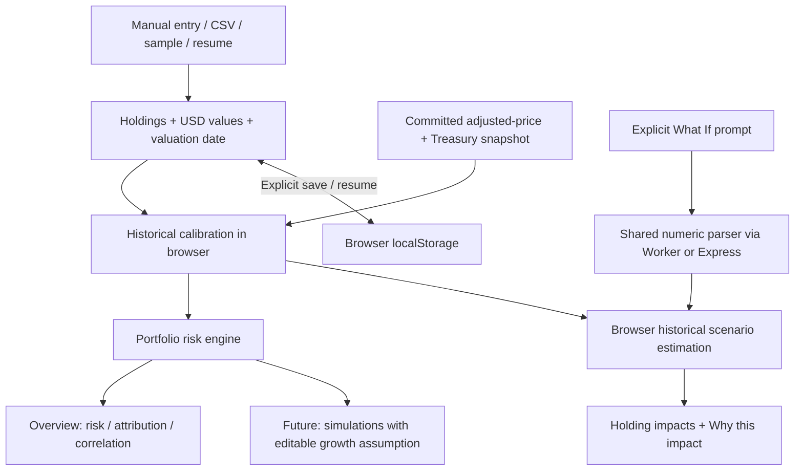

# Architecture

RiskLab separates portfolio inputs, historical calibration, quantitative calculations,
and optional AI explanations. The hosted app runs on Cloudflare; Express provides
local development and a Node deployment path.

## Product structure

`src/App.tsx` owns the open portfolio and its analysis settings. `/` is the welcome
page, and `/lab` contains setup and three views: Overview, What If, and Future.
`CopilotPanel` is a companion to those views. It preserves an in-memory conversation
when closed/reopened and resets it when holdings, invested amounts or historical
end dates change.

Portfolio inputs arrive through manual entry, sample portfolios, CSV import or
saved-portfolio resume. CSV values are reviewed before applying. Explicit saves
write inputs/settings to versioned localStorage; backups are a separate JSON format.
Raw import rows and Copilot conversations are not part of that saved schema.

## Data and calculation flow

The browser loads `public/models/historical-snapshot.json` and its content-addressed
parts. `riskSnapshot.ts` calibrates the selected holdings together;
`historicalModels.ts` constructs matching daily return intervals and estimates
covariance, volatility, correlations, beta and the historical arithmetic mean.
The analysis requires at least 126 common returns. Coverage failures retain inputs
for review instead of substituting a different security’s model.

`quantEngine.ts` calculates portfolio risk, signed volatility contributions,
normal-model VaR/Expected Shortfall and simulations. It also retains legacy
Black-Scholes/hedge-illustration utilities; those are not a separate current Lab
view. Future uses an editable compound-growth assumption, separate from the
historical mean used by the advanced risk metrics.

`measuredScenario.ts` fits joint conditional sensitivities for the explicitly
specified SPY, QQQM, SMH and 10-year Treasury yield changes. Holding overrides take
precedence. Missing sensitivities, inadequate shared history or unusable fits prevent
a complete modeled result. See [scenario estimation](scenario-model.md).

## API and AI boundaries

Both `worker.ts` and `server.ts` provide:

| Route | Role |
| --- | --- |
| `GET /api/health` | Service/provider configuration status; configuration alone does not prove live inference access. |
| `POST /api/gemini/parse-scenario` | Calls `api/scenario-parser.ts` to validate explicit directions, sizes, units and held tickers. No AI inference is used despite the historical route name. |
| `POST /api/gemini/ask-copilot` | Handles an explicit user question and active portfolio context, or an opt-in rule-based summary. |

The hosted Worker uses a Cloudflare Workers AI binding. Local Express uses the
server-side `GEMINI_API_KEY`; no provider key is supplied to the browser. Copilot
questions send active portfolio context to the configured service. Saved libraries
and raw CSV files are not sent. AI prose does not set scenario shocks or update
portfolio calculations, and provider failures remain labeled as unavailable.

## Persistence and refreshes

The PWA caches app assets, the symbol directory and historical snapshot. This cache
is separate from explicit portfolio saves in localStorage. Saves are device/browser/
origin specific and store allocation dates separately from snapshot provenance.
Resume recalculates current results; it does not revive cached simulation outputs.
See [saved inputs](saved-portfolios.md) and [CSV review](csv-import.md).

Historical refreshes run outside the interactive app. The Python batch pins a Dolt
source revision, builds adjusted indices and aligns official FRED DGS10 observations,
then writes snapshot parts before replacing the manifest. Quality metadata records
coverage, exclusions, action-feed cutoffs and reviewed/quarantined intervals.
The optional local Mac runner clones `main`, refreshes and validates in a disposable
checkout, then opens a data PR. It neither merges nor deploys directly.
See [refresh operations](model-refresh.md) and [data quality](historical-data-quality.md).

## Runtime and release paths

- **Development:** Express serves API routes with Vite middleware and hot reload.
- **Node production:** the Node build serves `dist/client` and API routes when
  started with `NODE_ENV=production`.
- **Cloudflare:** the Worker build emits `dist/server/index.js`; `wrangler.json`
  binds `dist/client` assets and sends `/api/*` to the Worker first.
- **Release:** the required GitHub validation job runs every suite, a snapshot
  report, and both builds. Feature branches receive previews; approved merges
  to the connected `main` branch trigger the production deployment.

## Remaining work

Current/proposed allocation comparison is planned. It must share a model revision,
historical window and scenario assumptions across both allocations. Independent
source reconciliation and chronological model evaluation remain research work;
input reports and regression tests do not establish forecast accuracy. Historical
replays and ETF look-through require additional verified data.
