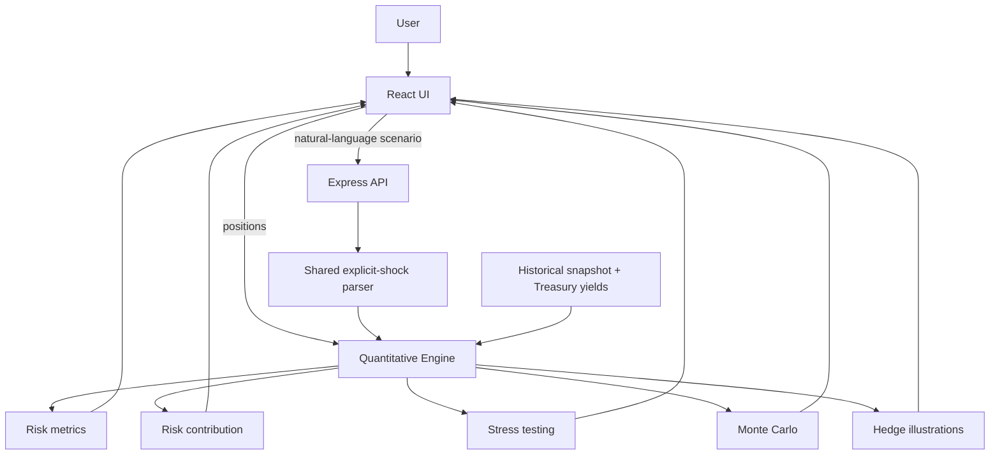
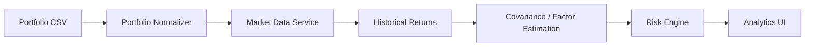

# Architecture

RiskLab is designed around a strict separation between **language interpretation** and **financial computation**.

## Design principle

> Explicit user scenarios are parsed into measurable assumptions; AI explanations do not control portfolio mathematics.

This boundary makes the system easier to test, reason about, and evolve.

## High-level flow

## Frontend

The frontend is a React + TypeScript application organized around several analytical views:

- portfolio risk and VaR
- correlation matrix
- risk contribution
- Monte Carlo simulation
- factor stress testing
- hedging lab

Portfolio edits trigger deterministic recalculation through `src/utils/quantEngine.ts`.

## Quantitative engine

The quantitative engine contains the financial models and has no dependency on Gemini. Its responsibilities include:

- modeled asset metadata
- portfolio normalization
- correlation construction and PSD projection
- covariance and portfolio variance
- risk contribution
- VaR / Expected Shortfall
- downside-risk metrics
- stress testing
- Monte Carlo simulation
- Black-Scholes option pricing
- illustrative hedge economics

Portfolio mathematics remain in `quantEngine.ts`; `historicalModels.ts` calibrates risk statistics and `measuredScenario.ts` handles historical stress sensitivities. The batch snapshot supplies reproducible inputs.

## API layer

`server.ts` provides:

- `/api/health`
- `/api/gemini/parse-scenario`
- `/api/gemini/ask-copilot`

The server owns the Gemini credential. The browser never receives the API key.

### Scenario safety boundary

Both deployments use `api/scenario-parser.ts` for explicit numeric shocks. It
validates supported drivers, magnitudes, directions, units and held ticker symbols.
Ambiguous requests return clarification errors; values are rejected rather than
silently clamped. It makes no AI call and does not invent missing magnitudes.

The browser estimates joint measured responses from the historical snapshot, and
refuses a portfolio total for missing coverage or invalid fits. See
[the scenario model](scenario-model.md). The copilot remains an optional AI
explanation service; its prose does not supply scenario price changes.

## Development / production

In development, Express hosts Vite in middleware mode so API and frontend requests share one server.

In production, Vite builds the browser application and the Express server serves the generated assets plus API endpoints.

## Future architecture direction

The next major boundary is a market-data service:

That will allow RiskLab to replace hand-entered market assumptions with reproducible historical inputs while retaining explicit forward-looking assumptions separately.
